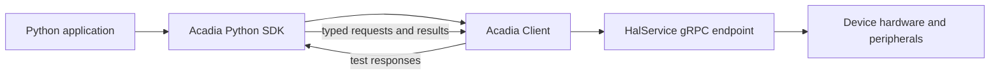

# Acadia Python SDK

The Acadia Python SDK is a typed Python client for the Acadia HAL gRPC service.
It lets test benches, lab tools, and automation scripts connect to an Acadia
device, discover its peripherals, and run hardware tests.

## Features

- Python 3.10 or newer.
- Typed Python dataclasses for HAL requests and results.
- Peripheral discovery during connection.
- Single-shot, monitoring, event-based, and long-running test modes.
- Context-managed connections that close automatically.
- SDK exceptions for connection, configuration, timeout, and test failures.

## Architecture



The application uses the SDK's typed API. The SDK sends requests to the
`HalService` endpoint hosted by the Acadia Client. The Client runs tests on
the device hardware and returns typed results to the application.

## Install

```bash
pip install acadia-sdk
```

The SDK supports Python 3.10 and newer. Generated gRPC bindings are included
in the package, so `grpcio-tools` is not required at runtime.

## Quick Start

The connection address uses the format `host:port`. The default HAL service
port is `50051`.

```python
import acadia_sdk

with acadia_sdk.connect("192.168.1.50:50051") as device:
	print("Available peripherals:", device.peripherals())

	imu = device.peripheral("imu")
	result = imu.run_oneshot()

	for test_result in result.results:
		print(test_result.name, test_result.output.status.name)
```

Using `with` closes the gRPC connection when the block finishes. You can also
manage the connection manually with `device = acadia_sdk.connect(...)` and
`device.close()`.

## Common Examples

### Read a metric

Metrics are stored in the result's `output.metrics` map. A metric can contain
a numeric, boolean, or string value.

```python
with acadia_sdk.connect("192.168.1.50:50051") as device:
	result = device.peripheral("imu").run_oneshot()
	test_result = result.results[0]
	accel_x = test_result.output.metrics["accel_x"].double_value
	print(f"accel_x = {accel_x:+.3f} g")
```

### Stream monitoring data

```python
with acadia_sdk.connect("192.168.1.50:50051") as device:
	imu = device.peripheral("imu")
	for snapshot in imu.monitor(period_ms=100, duration_s=2.0):
		value = snapshot.results[0].output.metrics["accel_x"].double_value
		print(f"accel_x = {value:+.3f} g")
```

### Wait for an event

```python
with acadia_sdk.connect("192.168.1.50:50051") as device:
	imu = device.peripheral("imu")
	for event in imu.arm_event(expression="accel_x > 0.5"):
		print("Threshold crossed:", event.results[0].name)
		break
```

### Run a long-running test

```python
with acadia_sdk.connect("192.168.1.50:50051") as device:
	cpu = device.peripheral("cpu")
	cpu.start_long_running(interval_ms=500, duration_s=60)
	try:
		while True:
			result = cpu.query_long_running(block=True, timeout=1.0)
			if result is None:
				break
			print(result.results[0].output.status.name)
	finally:
		cpu.stop_long_running()
```

## Documentation

- [Quickstart](docs/quickstart.md) - installation, connection, discovery, and test modes.
- [API reference](docs/api_reference.md) - public classes, methods, results, and exceptions.
- [Peripherals](docs/peripherals.md) - module discovery, configuration, metrics, and registered modules.
- [Error handling](docs/error_handling.md) - SDK exceptions and gRPC status mapping.
- [Versioning](docs/versioning.md) - SDK and HAL contract compatibility.
- [Examples](examples/README.md) - seven runnable walkthroughs.

## Run The Examples

Each example accepts an Acadia Client address. For example:

```bash
python examples/01_connect_and_discover.py 192.168.1.50:50051
python examples/02_imu_oneshot.py 192.168.1.50:50051
```

See the [examples guide](examples/README.md) for the complete list.

## License

Apache-2.0. See [LICENSE](LICENSE).
