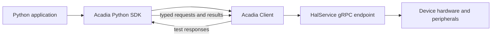

# Acadia Python SDK

The Acadia Python SDK is a typed Python client for the Acadia HAL gRPC service.
Use it to connect to an Acadia device, discover peripherals, and run hardware
tests from scripts, test benches, and automation tools.

## Features

- Supports Python 3.10 and newer.
- Connects to an Acadia HAL service over gRPC.
- Discovers available peripherals on connection.
- Provides single-shot, monitoring, event-based, and long-running tests.
- Includes typed dataclasses for HAL request and response data.
- Provides SDK exceptions for connection, configuration, timeout, and test errors.
- Supports context-managed connections that close automatically.

## Architecture



The application uses the SDK's typed Python API. The SDK sends requests to the
`HalService` gRPC endpoint hosted by the Acadia Client, which runs the tests
against the device hardware and returns the results to the application.

## Install

```bash
pip install acadia-sdk
```

## Example

```python
import acadia_sdk

with acadia_sdk.connect("192.168.1.50:50051") as device:
	print("Available peripherals:", device.peripherals())

	imu = device.peripheral("imu")
	result = imu.run_oneshot()

	print("Test result:", result)
```

The connection address uses the format `host:port`. The default Acadia HAL
service port is `50051`.

## License

Apache-2.0. See [LICENSE](LICENSE).
